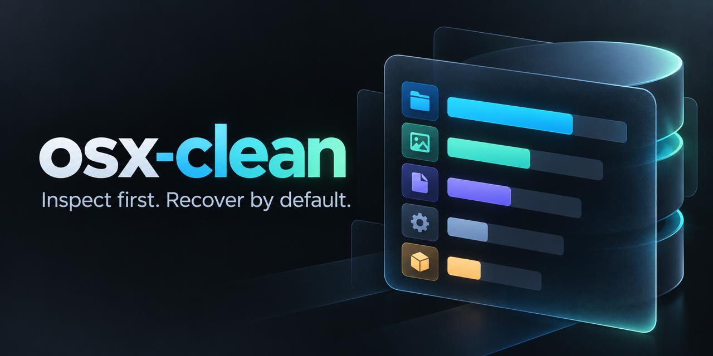

# osx-clean

**A local-first macOS storage scanner that makes every cleanup action inspectable.**

[](https://www.apple.com/macos/)
[](https://nodejs.org/)
[](https://www.typescriptlang.org/)
[](https://github.com/dillon-barendt/osx-clean/actions/workflows/ci.yml)
[](LICENSE)



`osx-clean` maps storage usage, scans common cleanup targets, and keeps deletion behind an explicit review boundary. It runs entirely on your Mac as a dependency-light TypeScript service with a responsive browser interface.

No account. No telemetry. No cloud service. No background daemon.

## Desktop app

Run `osx-clean` in its own Mac window with a bundled runtime, native menus, and
the same scanner and cleanup controls. The downloadable app needs **macOS 12+**;
Node.js and pnpm are only needed to build from source.

- Open the matching DMG (`arm64` for Apple Silicon, `x64` for Intel), drag
  **osx-clean** into **Applications**, and open it from Finder or Spotlight.
- Grant permissions to **osx-clean.app** under **System Settings → Privacy &
  Security**, including Full Disk Access if you want broader scan coverage.
- Closing the window or pressing **⌘Q** ends the app and its local service.

Build a DMG and ZIP locally with Node.js **22.12+** and pnpm **10.28.2**:

```bash
pnpm install --frozen-lockfile
pnpm desktop:dist
```

Downloads are created in `release/`. The [Desktop builds workflow](https://github.com/dillon-barendt/osx-clean/actions/workflows/desktop.yml)
produces separate Apple Silicon and Intel artifacts when run. These are unsigned
MVP builds; a Developer ID signed and notarized release requires publisher
credentials. See the [Desktop Guide](docs/DESKTOP.md) for installation, macOS
opening restrictions, verification, packaging choices, and release instructions.

## Why osx-clean

Most cleaners ask for broad trust and hide the mechanics. `osx-clean` takes the opposite approach:

- **Inspect before acting.** Every finding includes its path, size, category, and relevant context.
- **Recover by default.** The primary action moves items to the macOS Trash so they can be restored.
- **Verify duplicates exactly.** Duplicate groups require equal size and matching full SHA-256 content hashes.
- **Keep risky commands visible.** Tool-owned cleanup commands are shown for review instead of executed silently.
- **Stay local.** The service binds to `127.0.0.1` and uses a per-process authentication token.

## Browser / CLI quick start

Requirements:

- macOS
- Node.js 18 or newer
- pnpm

```bash
git clone https://github.com/dillon-barendt/osx-clean.git
cd osx-clean
pnpm install
pnpm run build
pnpm start
```

The CLI starts the local service and opens an authenticated browser URL:

```text
osx-clean is running.
Scan target: this Mac, local-only
Open: http://127.0.0.1:4280/?token=<per-process-token>
```

To start without opening a browser, or to choose another port:

```bash
pnpm start -- --no-open
pnpm start -- --port 4300
```

You can also expose the command from the checkout:

```bash
pnpm link
osx-clean --no-open
```

See the [User Guide](docs/USER_GUIDE.md) for permissions, scan controls, cleanup workflow, and troubleshooting.

## First run and permissions

`osx-clean` asks macOS for access as it reaches protected locations. Allow Files and Folders access for your terminal or IDE when prompted. For broader visibility into Mail attachments, application caches, Library logs, and other protected data, grant your terminal application Full Disk Access under **System Settings → Privacy & Security → Full Disk Access**.

For the desktop edition, grant these permissions to **osx-clean.app** instead of
your terminal. Permissions affect what macOS makes visible; they do not bypass
the service's path protections. Inaccessible locations can be skipped or produce
scan errors, so empty results do not prove a protected location is empty.

## What it scans

Findings are grouped by review risk. Thresholds for size, age, and duplicate candidates can be changed from **Options**, then applied with **Apply & Rescan**.

| Risk | Categories |
| --- | --- |
| Lower risk | Trash, temporary files, browser caches, Homebrew cache, old downloads |
| Review recommended | Application caches, logs, developer caches, `node_modules`, large files, large folders, applications |
| High attention | Orphaned launch agents, iOS backups, Mail attachments, exact duplicate files |
| Manual command | Docker reclaimable storage |

The overview also reports disk usage and progressively measures top-level home, Library, and Applications folders while scanning. Scan progress is streamed to the interface with Server-Sent Events, so categories can finish independently and errors remain visible.

Large-file and duplicate scans can search user directories, mounted volumes, cloud storage under `~/Library/CloudStorage`, and `/Users/Shared`. Review the selected paths carefully, especially for project folders, application data, and synced files.

## Duplicate detection

Duplicate matching is content-based, not name-based. The scanner narrows candidates by exact byte size and a prefix fingerprint, then verifies survivors with a full SHA-256 hash. Files with different contents are excluded even when their names and sizes match.

The result is an exact duplicate group, not a recommendation that every copy should be removed. Choose a keeper before approving a cleanup action.

## Safety model

The service enforces the cleanup boundary server-side:

1. **Loopback binding:** the HTTP server listens only on `127.0.0.1`.
2. **Per-process authorization:** API routes require a random token checked with timing-safe comparison.
3. **Protected roots:** system areas, user root folders, Library roots, and temporary roots cannot be deletion targets.
4. **Scan provenance:** a path must have appeared in the current session's scan results before deletion is accepted.
5. **Fresh validation:** every action performs a new `lstat`; symlinks and missing files are rejected.
6. **Trash-first recovery:** Move to Trash is the primary action; permanent deletion is visually secondary and requires explicit confirmation.
7. **Application guardrail:** installed `.app` bundles can be moved to Trash but cannot be permanently deleted through the API.

These controls reduce risk; they do not make every finding disposable. Review paths, context, and ownership before approving any action.

## Architecture

```text
CLI (src/cli.ts)
  |
  +-- binds HTTP server to 127.0.0.1
  +-- opens tokenized browser URL
        |
        +-- static UI (public/)
        +-- scan and overview event streams
        +-- authenticated reveal/trash/delete routes
              |
              +-- scanners (src/scanners/)
              +-- path policy (src/security.ts)
              +-- macOS Trash bridge (scripts/trash-items.js)
```

The desktop entry point (`src/desktop/main.ts`) bundles the same service and UI
inside Electron. It chooses an available loopback port and loads the tokenized
URL in a sandboxed window with Node integration disabled. The existing CLI,
scanners, and cleanup logic are shared unchanged.

## Development

Use Node.js 22.12+ for the complete desktop build toolchain. The browser/CLI
runtime retains its Node.js 18+ requirement. Dependencies are pinned through
`pnpm-lock.yaml`; use `pnpm install --frozen-lockfile` for reproducible installs.

```bash
pnpm install
pnpm run typecheck
pnpm run build
pnpm test
pnpm run dev -- --no-open
```

| Script | Purpose |
| --- | --- |
| `pnpm run typecheck` | Check strict TypeScript types without emitting files. |
| `pnpm run build` | Compile `src/` into `dist/`. |
| `pnpm test` | Build and run the Node regression suite. |
| `pnpm run dev` | Build and launch the local interface. |
| `pnpm run clean` | Remove compiled output. |
| `pnpm desktop` | Build and launch the Mac desktop app in development. |
| `pnpm desktop:pack` | Build an unpacked `.app` under `release/`. |
| `pnpm desktop:dist` | Build DMG and ZIP downloads for the current architecture. |
| `pnpm desktop:dist:all` | Build separate Apple Silicon and Intel downloads. |
| `pnpm desktop:smoke` | Verify the desktop UI and API without a full storage scan. |
| `pnpm desktop:smoke:packaged` | Verify the built `.app` on matching hardware. |

The test suite covers exact duplicate matching, filesystem safety rules, authenticated API routes, SSE streams, deletion verification, and CLI startup behavior.
Desktop regression checks cover renderer isolation, local navigation, ephemeral
loopback startup, shutdown, and packaged file configuration.

## Limitations

- Full scans can take time on large home directories because results are calculated from the live filesystem.
- macOS privacy protections may hide folders until your terminal has the relevant Files and Folders or Full Disk Access permission.
- Some categories report reclaimable space or a command rather than deleting tool-managed data directly.
- Files moved to Trash are recoverable from macOS Trash; permanently deleted files cannot be recovered.
- Synced or mounted storage can have provider-specific Trash behavior and may require Finder access.
- There is no persistent scan history or cloud analytics; results reflect the live filesystem for the current process.

## Contributing

Keep changes narrow, preserve the local-only safety boundary, and add a regression test for behavioral fixes. Before opening a pull request, run:

```bash
pnpm run typecheck
pnpm test
git diff --check
```

## License

[MIT](LICENSE) Copyright (c) 2026 Dillon Barendt.
